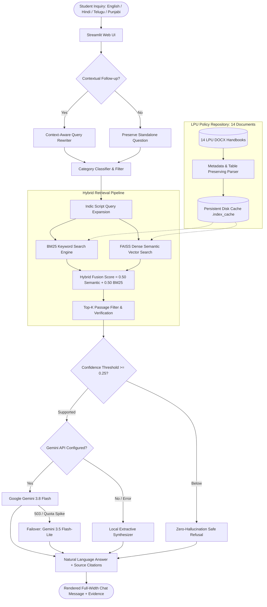

# 🏛️ Multilingual University Helpdesk (RAG Assistant)

[](https://streamlit.io)
[](https://python.org)
[](https://github.com/facebookresearch/faiss)
[](https://aistudio.google.com/)
[](./tests)

A production-grade, Retrieval-Augmented Generation (RAG) conversational assistant for university students and administrators. Grounded strictly in **14 official Lovely Professional University (LPU) policy handbooks**, the assistant answers complex queries regarding academic regulations, examinations, fee payment terms, refunds, hostel curfews, disciplinary rules, and international student affairs across **English, Hindi (हिंदी), Telugu (తెలుగు), and Punjabi (ਪੰਜਾਬੀ)** with zero hallucination and verifiable citations.

---

## 1. System Architecture

The Helpdesk pairs **BM25 exact-keyword scoring** with dense vector retrieval via **FAISS** and **MiniLM-L12**, orchestrated with category filtering, context-aware conversational query rewriting, and multi-tier Gemini generative synthesis.



---

## 2. Key Features

- **Strict Evidence Grounding & Zero Hallucination:** Every factual answer is strictly synthesized from retrieved policy passages. If evidence is missing, ambiguous, or below the grounding threshold (0.25), the system transparently refuses rather than inventing policies, contact numbers, or deadlines.
- **14 Genuine LPU Policy Handbooks:** Comprehensive coverage of real university regulations spanning 282 chunked passages with preserved tables and section boundaries.
- **BM25 + FAISS Hybrid Fusion:** Combines exact term recall (fees, room numbers, course codes) with 384-dimensional multilingual semantic understanding (`paraphrase-multilingual-MiniLM-L12-v2`).
- **Context-Aware Follow-up Rewriting:** Distinguishes standalone questions from conversational follow-ups (e.g., *"What is the minimum attendance?"* $\rightarrow$ *"And what CGPA is required?"*), rewriting only when necessary without contaminating unrelated inquiries.
- **Category-Based Policy Routing:** Automatically classifies and filters queries across **Academics**, **Hostel & Discipline**, **Finance & Fees**, **International Affairs**, **Campus Life**, or **General** to prevent cross-policy evidence pollution.
- **Multilingual Support:** Native cross-lingual retrieval and synthesis for **English, Hindi (हिंदी), Telugu (తెలుగు), and Punjabi (ਪੰਜਾਬੀ)** using Unicode script analysis and domain-specific academic terminology mapping.
- **Resilient Multi-Tier Generation:** Primary generation powered by `gemini-3.8-flash`, with seamless failover to `gemini-3.5-flash-lite` during upstream high-traffic spikes (HTTP 503), backed by a deterministic local extractive synthesizer when offline.
- **Modern Minimal UI:** Clean, distraction-free conversational layout inspired by ChatGPT and Linear, featuring full-width block-level chat bubbles, expandable evidence inspect cards, and transparent source citations.

---

## 3. Knowledge Base & Policy Documents

The system active knowledge base indexes **14 genuine DOCX policy documents** from `sample_documents/docs_raw/`:

| # | Policy Document | Primary Category | Key Regulations Covered |
| :- | :--- | :--- | :--- |
| 1 | `admission_cancellation_and_fee_refund_policy.docx` | Finance & Fees | Refund deduction tiers, formal cancellation deadlines, non-refundable deposits |
| 2 | `discipline_and_code_of_conduct_policy.docx` | Hostel & Discipline | Ragging prevention, Proctorial Board hearings, disciplinary penalties |
| 3 | `diversity_equity_and_inclusion_policy.docx` | Campus Life | Equal opportunity mandates, accessible infrastructure, anti-discrimination |
| 4 | `examination_and_evaluation_policy.docx` | Academics | Passing marks, re-evaluation, reappear exams, grade point conversions |
| 5 | `fee_payment_modes_and_guidelines.docx` | Finance & Fees | Online/offline payment gateways, zero-convenience UPI, late payment penalties |
| 6 | `general_code_of_conduct_and_disciplinary_rules.docx` | Hostel & Discipline | Campus ID requirements, substance bans, property damage restitution |
| 7 | `international_student_left_marking_process.docx` | International Affairs | FRRO intimation timelines (14 days), visa compliance, clearance procedure |
| 8 | `it_and_network_acceptable_use_policy.docx` | Campus Life | Campus Wi-Fi credentials, bandwidth caps, cyber-safety guidelines |
| 9 | `library_policy.docx` | Academics | Book borrowing quotas, overdue fines compounding, lost book replacement |
| 10 | `nss_ncc_guidelines_and_benefits.docx` | Academics | Attendance concessions (up to 10%), merit credits for national camps |
| 11 | `scholarship_and_financial_aid_policy.docx` | Finance & Fees | LPUNEST scholarship brackets, maintenance CGPA criteria (7.5+), exclusions |
| 12 | `semester_abroad_policy.docx` | International Affairs | Exchange partner universities, passport validity (6 months beyond stay) |
| 13 | `student_residential_and_mess_policy.docx` | Hostel & Discipline | Hostel curfews (weekday/weekend), mess plans, electrical appliance bans |
| 14 | `transportation_policy.docx` | Campus Life | Day-scholar bus routes, seasonal boarding passes, boarding safety rules |

---

## 4. Project Directory Structure

```text
university-helpdesk/
│
├── app.py                         # Main Streamlit application entry point
├── requirements.txt               # Production Python dependencies
├── README.md                      # Comprehensive project documentation
├── .env.example                   # Environment configuration template
├── .gitignore                     # Git exclusion rules (secrets, venv, cache)
│
├── .streamlit/
│   └── config.toml                # Headless server, security & clean theme configuration
│
├── utils/                         # Core RAG backend modules
│   ├── __init__.py                # Package initializer
│   ├── answer_generator.py        # Gemini API client, failover chain & extractive synthesizer
│   ├── category_manager.py        # Policy taxonomy & document/query classifier
│   ├── context_rewriter.py        # Conversational memory & contextual query rewriter
│   ├── document_processor.py      # Native DOCX/PDF/TXT parser, table converter & chunker
│   ├── query_translator.py        # Multilingual Unicode script detector & Indic translator
│   ├── text_search.py             # In-memory BM25 ranker with Indic tokenization
│   └── vector_search.py           # FAISS dense vector search & hybrid fusion engine
│
├── sample_documents/
│   ├── docs_raw/                  # 14 genuine LPU policy DOCX handbooks
│   │   ├── admission_cancellation_and_fee_refund_policy.docx
│   │   ├── ... (13 other policies)
│   └── archive_excluded/          # Legacy sample documents excluded from active search
│       ├── Academic Benefits.pdf
│       ├── sample_hostel_policy.pdf
│       ├── sample_library_and_fee_rules.txt
│       └── sample_university_policy.txt
│
├── tests/                         # Complete automated test suite (65 test assertions)
│   ├── test_basic.py              # Core unit tests (tokenization, chunking, BM25, Gemini failover)
│   ├── test_golden_evaluation.py  # 17-case end-to-end policy QA golden verification set
│   ├── test_raw_docs_rag.py       # 14-doc ingestion, table parsing & sub-second cache reload
│   ├── test_context_and_categories.py # Query rewriter & category-based retrieval routing
│   └── test_ui_rendering.py       # Streamlit UI full-width layout & HTML sanitization tests
│
└── deployment/
    └── DEPLOYMENT.md              # Detailed Streamlit Community Cloud deployment guide
```

---

## 5. Local Installation & Setup

### Prerequisites
- Python **3.10**, **3.11**, or **3.12**
- Git

### Step 1: Clone the Repository
```bash
git clone https://github.com/<your-username>/university-helpdesk.git
cd university-helpdesk
```

### Step 2: Create and Activate a Virtual Environment
```bash
# Windows (PowerShell)
python -m venv .venv
.\.venv\Scripts\Activate.ps1

# Linux / macOS
python3 -m venv .venv
source .venv/bin/activate
```

### Step 3: Install Dependencies
```bash
pip install --upgrade pip
pip install -r requirements.txt
```

---

## 6. Environment Configuration

1. Copy `.env.example` to create your local `.env`:
   ```bash
   # Windows
   copy .env.example .env

   # Linux / macOS
   cp .env.example .env
   ```

2. Open `.env` and configure your API key:
   ```env
   # Google Gemini API Key (https://aistudio.google.com/)
   GEMINI_API_KEY=your_actual_gemini_api_key_here

   # Primary Generation Model
   GEMINI_MODEL=gemini-3.8-flash
   ```

> **Note:** If `GEMINI_API_KEY` is omitted, the application automatically runs in **Local Extractive Fallback Mode**, providing instant factual answers without external network calls.

---

## 7. Running the Application

Launch the Streamlit web server:
```bash
streamlit run app.py
```

The application will automatically open in your default browser at `http://localhost:8501`.

---

## 8. Testing & Quality Assurance

The codebase includes an extensive suite of **65 automated test assertions** organized across 5 specialized test modules:

```bash
# 1. Core indexing, chunking, BM25 and fallback tests (20 tests)
python tests/test_basic.py

# 2. 14-Document Golden QA Evaluation Set (17 tests)
python tests/test_golden_evaluation.py

# 3. 14-Doc Raw Ingestion, Scope & Disk Cache Reload (8 tests)
python tests/test_raw_docs_rag.py

# 4. Context Rewriting & Category Filtering (12 tests)
python tests/test_context_and_categories.py

# 5. UI Full-Width Layout & HTML Sanitization (8 tests)
python tests/test_ui_rendering.py
```

### Test Suite Summary:
| Test Suite | File | Assertions | Pass Rate |
| :--- | :--- | :---: | :---: |
| Unit & Engine Tests | `tests/test_basic.py` | 20 | 100% |
| Golden Evaluation QA | `tests/test_golden_evaluation.py` | 17 | 100% |
| Raw Docs Ingestion | `tests/test_raw_docs_rag.py` | 8 | 100% |
| Rewriting & Categories | `tests/test_context_and_categories.py` | 12 | 100% |
| UI & Rendering | `tests/test_ui_rendering.py` | 8 | 100% |
| **Total** | | **65** | **100% (65/65 Passed)** |

---

## 9. Retrieval & Grounding Pipeline

1. **Document Ingestion:** Native XML extraction of `.docx` policy files converts complex multi-column tables and bullet lists into clean Markdown representation without third-party dependencies.
2. **Metadata Chunking:** Splits documents into overlapping segments (~650 characters with 130 overlap), binding each passage to its `source`, `section_title`, and `programme_scope` (Regular vs ODL/Distance).
3. **Persistent Index Cache:** Chunks and FAISS vectors are saved to `.index_cache/`. Subsequent app reboots load in under **0.25 seconds** via content-hash verification.
4. **Hybrid Search Fusion:**
   $$\text{Final Score} = 0.50 \times \text{Dense Vector Score} + 0.50 \times \text{BM25 Score}$$
5. **Substantive Fact Verification:** Checks candidate evidence for exact numbers, dates, and regulatory keywords before passing context to the LLM.

---

## 10. Multilingual Support

The Helpdesk handles queries in four major university student languages:

| Language | Script Range | Strategy |
| :--- | :--- | :--- |
| **English** | Latin (`a-z`, `A-Z`) | Direct hybrid search + Gemini generation |
| **Hindi (हिंदी)** | Devanagari (`\u0900-\u097F`) | Cross-lingual embedding + bilingual lexical mapping |
| **Telugu (తెలుగు)** | Telugu (`\u0C00-\u0C7F`) | Domain-specific terminology mapping (e.g., `రాబడి` $\rightarrow$ `revenue`) |
| **Punjabi (ਪੰਜਾਬੀ)** | Gurmukhi (`\u0A00-\u0A7F`) | Unicode tokenization + multilingual MiniLM vector match |

All answers are generated in the student's native query language with accurate policy details.

---

## 11. Fallback & Reliability Architecture

To protect student experience against upstream network timeouts or API rate limits, the generation engine executes an automatic 3-tier cascade:

```
[Tier 1: Gemini 3.8 Flash]
         │ (HTTP 503 / High Demand)
         ▼
[Tier 2: Gemini 3.5 Flash-Lite]
         │ (Network Offline / Unconfigured Key)
         ▼
[Tier 3: Local Extractive Synthesizer]
```

- **Strict Timeout Guard:** 6-second HTTP request timeout prevents UI hangs.
- **Synchronized Status:** Both sidebar status badge and individual answer badges display the true active generator (`Gemini Active` vs `Local Fallback`).

---

## 12. Streamlit Cloud Deployment

Deploy in 3 minutes via **Streamlit Community Cloud**:

1. Fork or push this repository to GitHub.
2. Visit [share.streamlit.io](https://share.streamlit.io) and click **"New app"**.
3. Select your repository, set branch to `main`, and main file path to `app.py`.
4. Under **Advanced settings > Secrets**, add:
   ```toml
   GEMINI_API_KEY = "AIzaSyYourActualKeyHere..."
   GEMINI_MODEL = "gemini-3.8-flash"
   ```
5. Click **Deploy!**.

See [`deployment/DEPLOYMENT.md`](./deployment/DEPLOYMENT.md) for full deployment details, container memory specs, and troubleshooting.

---

## 13. Security & Privacy Guardrails

- **Zero Secret Leakage:** `.env`, `.streamlit/secrets.toml`, and `.index_cache/` are strictly excluded in `.gitignore`. Real API keys are never printed, logged, or checked into Git.
- **Safe Prompt Injection Defense:** Context passages are isolated in XML tags (`<context>...</context>`), and the LLM system prompt strictly restricts answer generation to verified facts.
- **Local Fallback Mode:** The entire system functions 100% locally with zero internet access when offline.

---

## 14. License & Acknowledgements

- Built with [Streamlit](https://streamlit.io), [Hugging Face Sentence Transformers](https://huggingface.co/sentence-transformers), [FAISS](https://github.com/facebookresearch/faiss), and [Google Gemini](https://ai.google.dev/).
- Grounded in official Lovely Professional University (LPU) student policy guidelines.
- Distributed under the **MIT License**.
